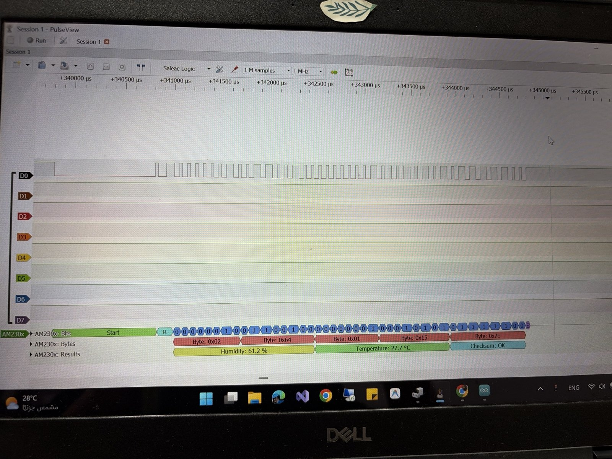

# DHT22 signal simulation

**Goal:** see and decode the DHT22 one-wire protocol at the signal level, without needing the sensor (mine got damaged).

The ESP32 pretends to be a DHT22 on GPIO4 ([`dht22-signal-simulation.ino`](dht22-signal-simulation.ino)). The logic analyzer (CH1 on GPIO4, 1 MHz, 1 M samples) records the frame and PulseView decodes it.

## Frame structure
1. Host start: line pulled LOW for about 1 ms
2. About 30 µs HIGH, then the sensor response: about 80 µs LOW, about 80 µs HIGH
3. 40 data bits. Each bit is about 50 µs LOW, then HIGH for about **27 µs (0)** or about **70 µs (1)**
4. Bytes: humidity high, humidity low, temperature high, temperature low, checksum

## Result
PulseView's **AM230x** decoder (AM2302 is the DHT22):

| Byte | Value |
|---|---|
| 1 | 0x02 |
| 2 | 0x64 |
| 3 | 0x01 |
| 4 | 0x15 |
| 5 | 0x7C (checksum, OK) |

- Humidity = (0x02 × 256 + 0x64) / 10 = **61.2 %**
- Temperature = (0x01 × 256 + 0x15) / 10 = **27.7 °C**
- Checksum = (0x02 + 0x64 + 0x01 + 0x15) & 0xFF = 0x7C

I also decoded the first byte by hand from the pulse widths (`0 0 0 0 0 0 1 0` = 2), and it matched the decoder.

## What I learned
<!-- TODO (in my own words): how the protocol encodes 0 and 1 with timing, why 1 MHz sampling is needed -->
