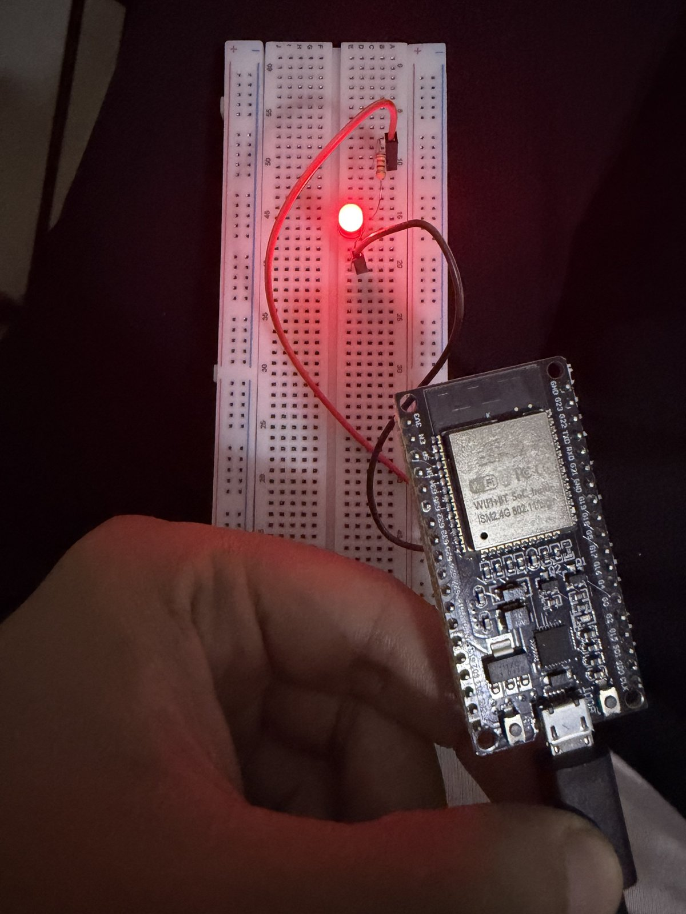

# Week 1: ESP32 Blink

**Goal:** get the toolchain working end to end: driver, Arduino IDE, upload, serial output, and a real circuit on a breadboard.

## Setup
- ESP32 DevKit 38-pin with an on-board CP2102 USB-UART bridge
- Silicon Labs CP210x driver installed (before that, Device Manager showed *CP2102 USB to UART Bridge Controller* under *Other devices* with a warning icon and no COM port)
- Arduino IDE 2.x, board package *esp32 by Espressif Systems*, board **ESP32 Dev Module**

## Circuit
`GPIO2 → 220 Ω resistor → LED (long leg +) → GND`

| LED on | LED off |
|---|---|
|  |  |

## Result
The sketch [`week1-blink.ino`](week1-blink.ino) blinks the LED every second and prints `LED ON` / `LED OFF` in the Serial Monitor at 115200 baud.

## What I learned
<!-- TODO (in my own words): what the driver does, why a 220 Ω resistor, what went wrong and how I fixed it -->
